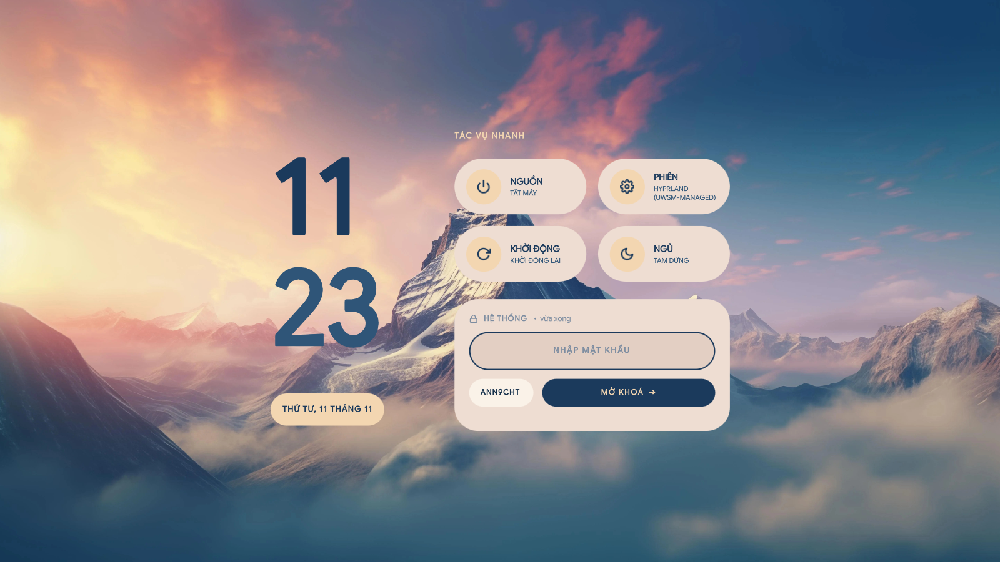
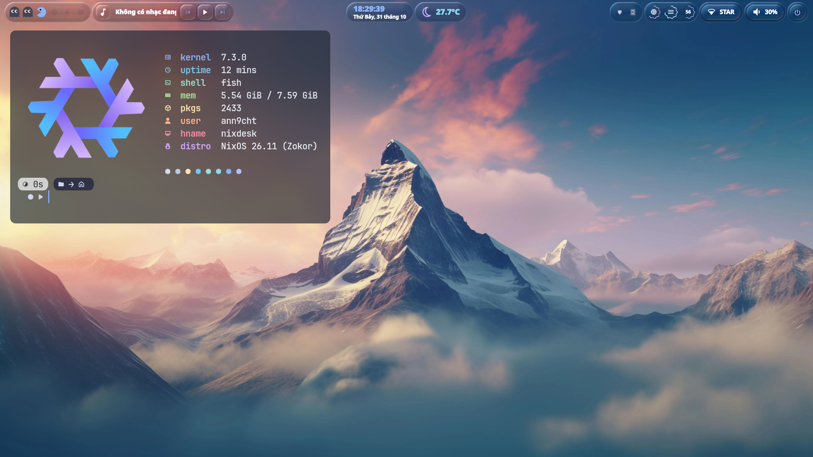
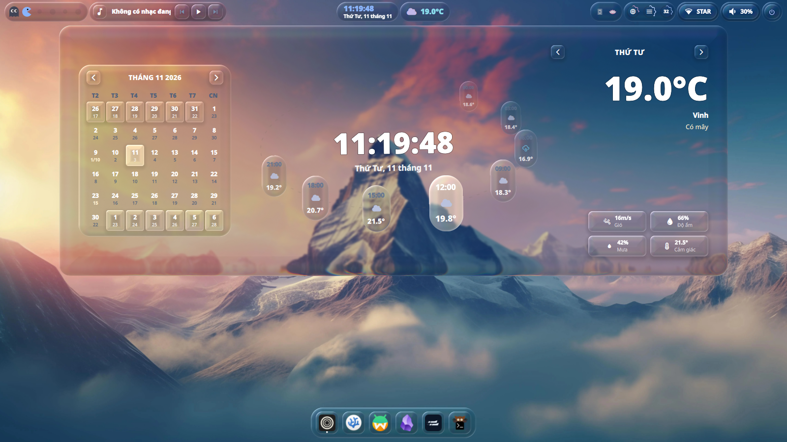
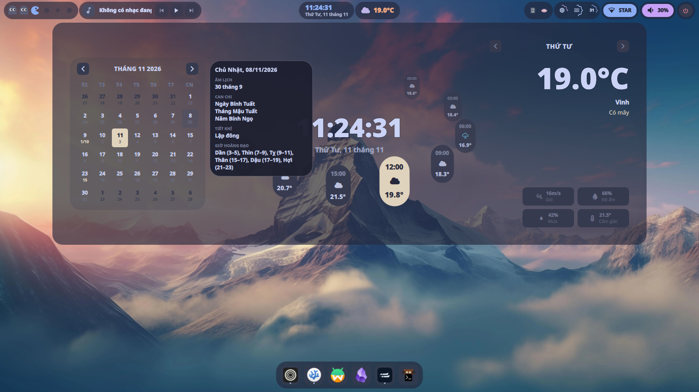
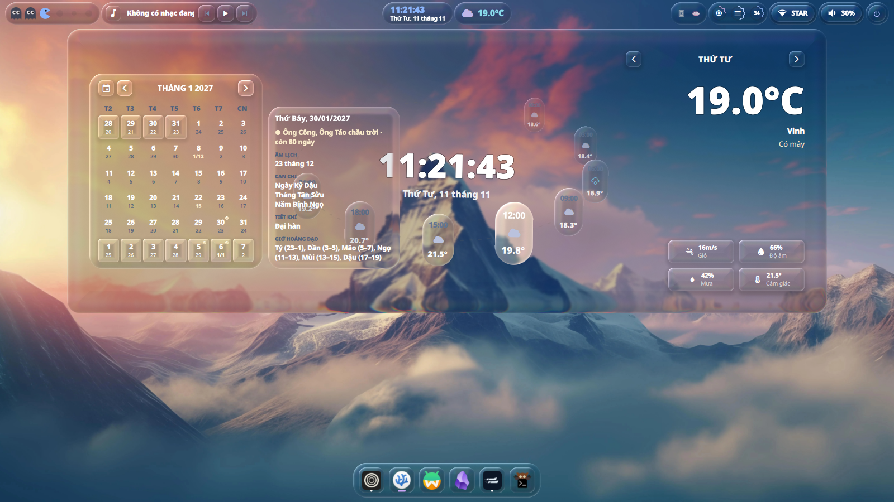
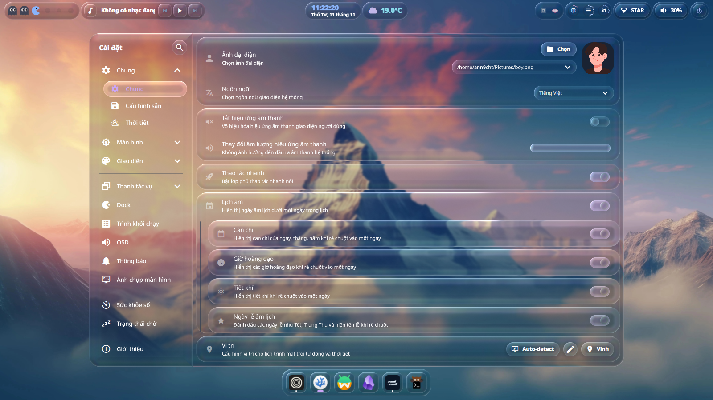

  
  &nbsp;&nbsp;&nbsp;&nbsp;
  
  &nbsp;&nbsp;&nbsp;&nbsp;
  

<h1 align="center">ann9cht/nixos-config</h1>

  Cấu hình NixOS tối thiểu để chạy Serpantinum trên Hyprland, kèm lịch âm cho người Việt.

<table align="center">
  <tr>
    <td width="50%">
      
    </td>
    <td width="50%">
      
    </td>
  </tr>
  <tr>
    <td align="center">Chủ đề SDDM</td>
    <td align="center">Màn hình chính</td>
  </tr>
</table>

## Giới thiệu

Cấu hình sử dụng flake NixOS cùng Home Manager cho host `nixdesk`, giữ ở mức tối thiểu cần thiết để chạy shell [Serpantinum](https://github.com/ilyamiro/serpantinum) trên Hyprland.

Serpantinum đã bật phần lớn dịch vụ hệ thống (mạng, Bluetooth, âm thanh, trình quản lý tệp Ski), nên cấu hình này chỉ khai báo những gì còn lại.

## Điểm khác biệt so với Serpantinum

Ngoài cấu hình hệ thống, repo này áp thêm một số tùy biến lên Serpantinum bản gốc:

- **Lịch âm (âm lịch Việt Nam)**: thêm vào popup lịch của shell, dựa trên thuật toán của Hồ Ngọc Đức. Xem preview ở bên dưới.
- **Chủ đề SDDM**: tùy chỉnh từ theme `material-you` từ [qylock](https://github.com/Darkkal44/qylock), được Việt hóa và chỉnh lại màu nút, màu chữ.

### Lịch âm

Lịch âm chỉ khả dụng khi ngôn ngữ giao diện là **Tiếng Việt**, và hoạt động ở cả ba kiểu giao diện (mặc định, mờ đục/làm mờ, kính lỏng).

- Ngày âm hiển thị nhỏ ngay bên dưới
- Tháng nhuận được đánh dấu bằng chữ **N**
- Rê chuột vào một ngày bất kỳ để xem can chi của tháng/năm, giờ hoàng đạo, tiết khí
- Ngày lễ (Tết, Trung Thu...) được đánh dấu ngay trên ô ngày, kèm đếm ngược ngay trong bảng chi tiết
- Có khối cài đặt riêng: bật/tắt chung, cùng các tùy chọn con (ngày âm, can chi, giờ hoàng đạo, tiết khí) và tùy chọn riêng cho ngày lễ

<table align="center">
  <tr>
    <td width="50%">
      
    </td>
    <td width="50%">
      
    </td>
  </tr>
  <tr>
    <td align="center">Lịch âm trong popup lịch</td>
    <td align="center">Chú giải khi rê chuột</td>
  </tr>
  <tr>
    <td width="50%">
      
    </td>
    <td width="50%">
      
    </td>
  </tr>
  <tr>
    <td align="center">Đánh dấu ngày lễ</td>
    <td align="center">Cài đặt lịch âm</td>
  </tr>
</table>

## Cảm ơn

- [Serpantinum](https://github.com/ilyamiro/serpantinum): shell mà cấu hình này xoay quanh.
- [qylock](https://github.com/Darkkal44/qylock): chủ đề SDDM `material-you`.
- Hồ Ngọc Đức: thuật toán tính âm lịch.
